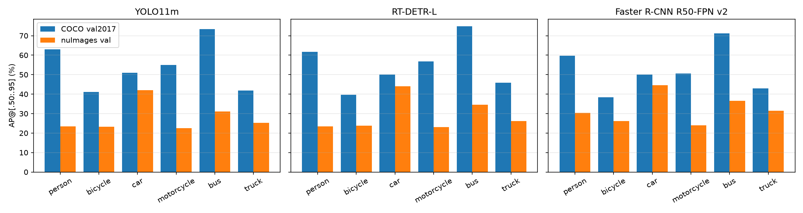
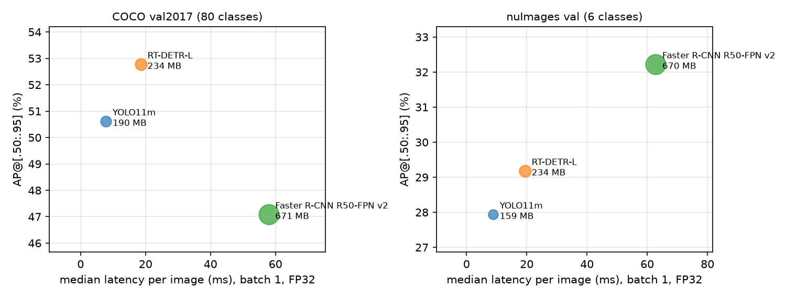
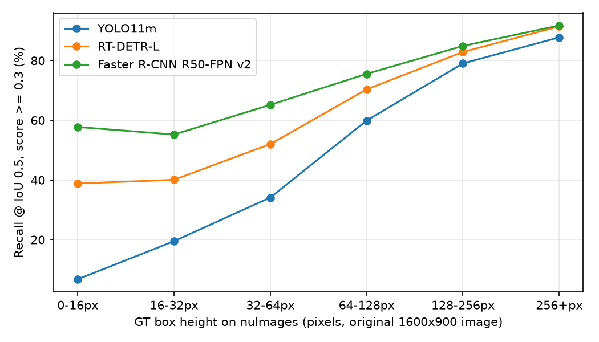
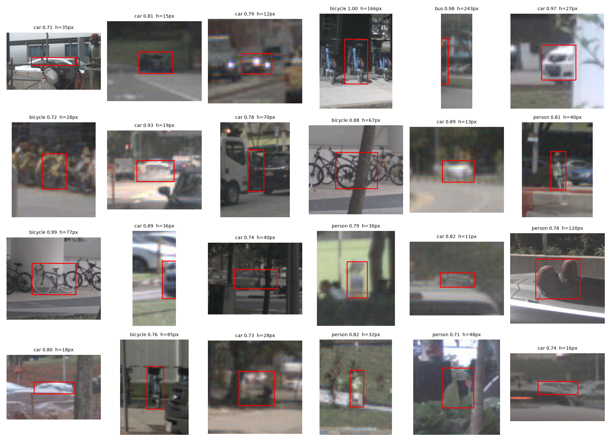
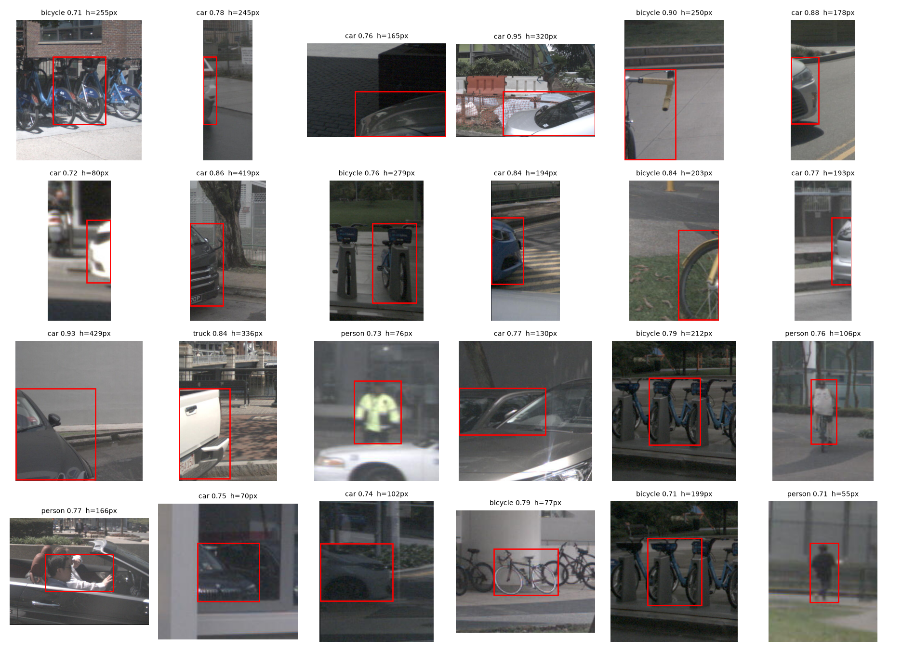

# From COCO to the Street: Zero-Shot Transfer of 3 2D Detector Families to nuImages

**CMPE 249 Homework, Track A (Experimental)** | JiHoon Yoon | October 2026<br>
Code, configs and logs: https://github.com/jihoonyoon-sjsu/cmpe249-hw-2d-detection

## Abstract

We tested 3 COCO-pretrained detectors from 3 different families: **YOLO11m** (one-stage, anchor-free CNN), **RT-DETR-L** (query-based real-time transformer, no NMS) and **Faster R-CNN R50-FPN v2** (two-stage, anchor-based). We ran them on COCO val2017 and then, *without any retraining*, on the nuImages v1.0 validation set (16,445 images from self-driving cars). First we reproduced the published COCO numbers to within 0.9 AP. On the 6 classes both datasets share, all 3 models lose about 38-48% of their AP when moved to driving images, and the rankings flip. Faster R-CNN (oldest and least accurate on COCO, 52.1 -> 32.2 AP) becomes the best on nuImages. RT-DETR-L is second (54.8 -> 29.2) and then YOLO11m (54.2 -> 27.9). Most of the drop is on small objects, where AP goes from 31-35 down to 4-11. That gap follows how many pixels each model actually uses from the 1600x900 images a lot more than how good the model is on COCO. The failure analysis shows that a big part of the remaining "errors" comes from **the 2 datasets labeling things differently**, not from the detectors being bad. For example, nuImages puts the rider inside the bike box, puts parked bikes inside "bicycle rack" boxes, and has its own rules for when a van or pick-up is a car or a truck. A clean speed test (YOLO11m 8.9 ms, RT-DETR-L 19.5 ms, Faster R-CNN 62.8 ms per nuImages image) shows that the extra resolution that helps Faster R-CNN is also what makes it the slowest.

## 1. Models

| | YOLO11m | RT-DETR-L | Faster R-CNN R50-FPN v2 |
|---|---|---|---|
| Family | one-stage, anchor-free CNN | query-based transformer (DETR line) | two-stage, anchor-based (RPN + RoI head) |
| Checkpoint | `yolo11m.pt` (Ultralytics) | `rtdetr-l.pt` (Ultralytics) | torchvision `FasterRCNN_ResNet50_FPN_V2_Weights.COCO_V1` |
| Backbone / neck | CSP-style backbone + PAN neck | HGNetv2 + hybrid encoder (AIFI + CCFF) | ResNet-50 + FPN |
| Post-processing | class-wise NMS (IoU 0.7) | none (one-to-one matching, top-300 queries) | per-class NMS (IoU 0.5) |
| Params (measured) | 20.1 M | 33.0 M | 43.7 M |
| GFLOPs | 68.6 @640 (measured) | 110.2 @640 (measured) | 280.4 (torchvision docs) |
| Input size | long side 640, keeps aspect ratio (letterbox) | stretched to 640x640 (`scale_fill=True`) | short side 800, long side up to 1333 |
| Published COCO AP | 51.5 [7] | 53.0 [8] | 46.7 [9] |

We picked these 3 so they cover the main design choices from class: one-stage vs. two-stage, anchor-free vs. anchor-based, and NMS vs. set prediction (Hungarian matching, no NMS) [1-5].

## 2. Datasets and taxonomy mapping

**COCO val2017** [6]: 5,000 images, 80 classes, usually about 640x480. This is the kind of data the models were trained on.
**nuImages v1.0-val** [10, 11]: 16,445 key-frame images from 6 cameras on cars in Boston and Singapore, 1600x900, with 136,074 2D boxes in 24 classes. None of the models has seen it.

The 2 datasets use different class lists, so we only grade the 6 COCO classes that have a clear nuImages match. Here is the full mapping (from `src/nuimages_to_coco.py`):

| COCO class | nuImages categories -> graded | nuImages categories -> *ignore region* (iscrowd=1) |
|---|---|---|
| person | pedestrian.adult, .child, .construction_worker, .police_officer | pedestrian.personal_mobility, .stroller, .wheelchair |
| bicycle | vehicle.bicycle | - |
| car | vehicle.car, vehicle.emergency.police | - |
| motorcycle | vehicle.motorcycle | - |
| bus | vehicle.bus.bendy, vehicle.bus.rigid | - |
| truck | vehicle.truck, vehicle.construction, vehicle.emergency.ambulance | vehicle.trailer |

*Not graded (no COCO match):* barrier, traffic cone, debris, pushable/pullable, bicycle rack, animal, ego vehicle.

Ignore regions work like COCO's "crowd" boxes. If a model puts a box on a trailer or on a person riding a scooter, it doesn't count as right or wrong. That way a COCO model isn't punished for a reasonable answer on something nuImages labels in a way COCO doesn't have. In total that's 97,013 boxes on 16,445 images: 96,002 graded and 1,011 ignore regions (counts per category are in `logs/nuimages_to_coco.log`). To compare fairly, we also re-scored the COCO results on just the same 6 classes ("COCO-6"). COCO-6 has 14,073 ground-truth boxes and nuImages has 96,002 graded boxes (person 32,185, car 47,314, truck 8,169, bicycle 3,352, motorcycle 3,097, bus 1,885).

*Note on size buckets:* COCO decides small/medium/large using the area of the object's outline (segmentation mask), but for nuImages we use the box area (width x height). Box area is always a bit bigger, so nuImages objects get pushed slightly toward the bigger buckets. If anything, that makes the small-object gap below look smaller than it really is.

## 3. Experimental setup

| Item | Value |
|---|---|
| GPU / CPU | NVIDIA GeForce RTX 4070 Ti (12 GB, driver 621.01) / AMD Ryzen 9 7900X |
| OS | Ubuntu 22.04.5 under WSL2 on Windows 11 Pro |
| Software | Python 3.11.18, PyTorch 2.5.1 + CUDA 12.4, cuDNN 9.1, torchvision 0.20.1, Ultralytics 8.4.190, pycocotools 2.0.11 |
| Precision / batch | FP32, batch size 1 |
| Thresholds (accuracy runs) | score >= 0.001, max 300 detections per image, NMS IoU as in Section 1 |
| Metric | pycocotools `COCOeval` (bbox): AP@[.50:.95], AP50, AP75, AP S/M/L, AR@100, per-class AP |
| Latency definition | from the decoded image in memory to the final boxes on the CPU (pre-processing + model + post-processing/NMS), with `torch.cuda.synchronize()` before and after, after 50 warm-up runs |
| GPU memory | `torch.cuda.max_memory_allocated()` during the timed loop |

The low score threshold (0.001) and 300 detections per image are the normal settings for COCO evaluation. They get the most out of the AP score, but nobody would actually run a detector like that in a real car. So the failure analysis in Section 6 uses a fixed score threshold of 0.3 instead.

**Exact commands** (all from the repository root, conda env `det`):

```
python src/nuimages_to_coco.py --out data/nuimages_val_coco6.json            # build nuImages GT
bash run_all.sh coco        # 3 models x COCO val2017 -> results/coco/<model>/{detections,metrics,metrics_6cls,speed}.json
bash run_all.sh nuimages    # 3 models x nuImages val -> results/nuimages/<model>/...
bash run_speed.sh           # clean latency/memory benchmark, 1000 images per dataset, GPU otherwise idle
python src/analyze.py       # figures + failure analysis -> report/figs, report/analysis.json
```

For each model, `run_all.sh` runs
`python src/run_detector.py --model <yolo11m|rtdetr-l|fasterrcnn_r50_fpn_v2> --gt <gt.json> --img-root <dir> --out <dir>`
and then `python src/evaluate.py --gt <gt.json> --dets <dir>/detections.json --out <dir>/metrics.json [--cats 1,2,3,4,6,8]`. The console output of every run is in `logs/`.

## 4. Results

### 4.1 Reproducing COCO (sanity check)

| Model | AP | AP50 | AP75 | AP_S | AP_M | AP_L | AR@100 | Published AP |
|---|---|---|---|---|---|---|---|---|
| YOLO11m | 50.6 | 67.3 | 55.0 | 33.5 | 56.1 | 66.4 | 66.1 | 51.5 |
| RT-DETR-L | **52.8** | **71.3** | **57.2** | **34.4** | **57.4** | **70.8** | **71.7** | 53.0 |
| Faster R-CNN v2 | 47.1 | 68.2 | 51.4 | 31.6 | 50.9 | 60.4 | 64.8 | 46.7 |

All 3 are within 0.9 AP of the published numbers. The small gap for YOLO11m is probably because we used plain `predict` (each image gets its own minimal letterbox) instead of Ultralytics' `val` pipeline, but we didn't dig into it further. Either way, this shows our pipeline works before we move to the new dataset.

### 4.2 Zero-shot transfer to nuImages (6 shared classes)

| Model | COCO-6 AP | nuImages AP | Change (rel.) | AP50 C->N | AP75 C->N | AP_S C->N | AP_M C->N | AP_L C->N | AR@100 C->N |
|---|---|---|---|---|---|---|---|---|---|
| YOLO11m | 54.2 | 27.9 | -26.3 (-48%) | 73.9 -> 44.7 | 58.4 -> 26.8 | 31.2 -> 4.3 | 58.7 -> 20.2 | 74.9 -> 52.2 | 66.7 -> 40.5 |
| RT-DETR-L | **54.8** | 29.2 | -25.6 (-47%) | 76.3 -> 48.9 | 58.5 -> 27.4 | 32.6 -> 6.2 | 58.1 -> 22.2 | **76.8** -> 51.6 | **71.6** -> 49.8 |
| Faster R-CNN v2 | 52.1 | **32.2** | **-19.9 (-38%)** | **77.0 -> 56.4** | 55.9 -> **30.2** | **35.1 -> 11.3** | 54.0 -> **26.8** | 69.3 -> 50.4 | 66.5 -> **50.4** |



**Per-class AP@[.50:.95], COCO-6 -> nuImages:**

| Class | YOLO11m | RT-DETR-L | Faster R-CNN v2 | rel. drop (Y / R / F) |
|---|---|---|---|---|
| person | 63.1 -> 23.5 | 61.7 -> 23.5 | 59.7 -> 30.4 | 63% / 62% / 49% |
| bicycle | 41.2 -> 23.2 | 39.6 -> 23.8 | 38.4 -> 26.2 | 44% / 40% / 32% |
| car | 51.0 -> 42.0 | 50.1 -> 44.1 | 50.0 -> 44.6 | 18% / 12% / 11% |
| motorcycle | 55.0 -> 22.5 | 56.7 -> 23.1 | 50.6 -> 24.0 | 59% / 59% / 52% |
| bus | 73.4 -> 31.1 | 74.7 -> 34.6 | 71.2 -> 36.6 | 58% / 54% / 49% |
| truck | 41.9 -> 25.3 | 45.9 -> 26.1 | 42.9 -> 31.5 | 40% / 43% / 27% |

### 4.3 Speed and memory (controlled benchmark)

We measured this with `run_speed.sh` on the first 1,000 images of each dataset after 50 warm-up runs. Nothing else was using the GPU (the desktop used 771 MiB and 2% utilization at the start; see `logs/speed_gpu_state.txt`). Batch size 1, FP32, plain PyTorch (no TensorRT, no FP16).

| Dataset | Model | Median latency (ms) | Mean (ms) | p90 (ms) | Throughput (img/s) | Peak GPU mem. allocated / reserved (MB) |
|---|---|---|---|---|---|---|
| COCO | YOLO11m | **7.9** | 8.7 | 9.4 | **115.0** | **190** / 358 |
| COCO | RT-DETR-L | 18.6 | 18.9 | 20.3 | 52.8 | 234 / 306 |
| COCO | Faster R-CNN v2 | 57.9 | 57.8 | 63.2 | 17.3 | 671 / 1,608 |
| nuImages | YOLO11m | **8.9** | 8.9 | 9.8 | **111.8** | **160** / 212 |
| nuImages | RT-DETR-L | 19.5 | 19.7 | 20.6 | 50.8 | 234 / 306 |
| nuImages | Faster R-CNN v2 | 62.8 | 62.6 | 65.0 | 16.0 | 670 / 784 |

Latency includes NMS / top-K and copying the boxes back to the CPU. Memory is PyTorch's own peak and doesn't include the CUDA context itself.



## 5. Technical analyses

### 5.1 Cross-dataset generalization: which classes and sizes get worse?

**Object size matters the most.** For all 3 models, large objects keep about 70% of their COCO AP (about 50-52 on nuImages), but small objects only keep 14-32%. You can see this clearly when you look at recall at a fixed setting (score >= 0.3, IoU >= 0.5) by how tall the ground-truth box is in the original 1600x900 image:



| GT height (px) | 0-16 | 16-32 | 32-64 | 64-128 | 128-256 | > 256 |
|---|---|---|---|---|---|---|
| YOLO11m | 6.7 | 19.5 | 34.1 | 59.9 | 79.0 | 87.8 |
| RT-DETR-L | 38.8 | 40.1 | 52.0 | 70.4 | 82.9 | 91.4 |
| Faster R-CNN v2 | **57.7** | **55.2** | **65.2** | **75.6** | **84.9** | **91.7** |

It's not just that nuImages has more small objects. COCO-6 actually has *more* small boxes (42%) than nuImages (24%). What's different is **how many pixels reach the network**. COCO images are about 640 px wide, so a model that takes 640 px sees them at their real size. But a nuImages image is 1600x900. YOLO11m shrinks it to 640x384 (0.4x in both directions), so a pedestrian who is 32 px tall becomes about 13 px, which is only about 1.6 cells on its finest feature map (stride 8). RT-DETR-L stretches it to 640x640 (0.4x wide and 0.71x tall), so the same pedestrian stays about 23 px tall but gets 2.5x thinner. Faster R-CNN resizes it to 1333x750 (0.83x), so the pedestrian stays about 27 px. (On COCO it's the opposite, Faster R-CNN actually *blows up* a 640x480 image to about 1067x800.) The order of how big objects end up (YOLO11m < RT-DETR-L < Faster R-CNN) matches the order of small-object AP and tiny-object recall exactly. We think this is the main reason the *least* accurate COCO model ends up being the *most* accurate on driving data. This is a hypothesis backed by the size breakdown, and the direct test (running YOLO11m at 1280 px) is left as future work.

**Classes.** *Car* holds up the best (-11 to -18%). It's by far the most common class in nuImages, and cars on roads (from the back or side) show up a lot in COCO street photos too. *Person*, *motorcycle* and *bus* drop the most (about 50-63%). For *person* it's mostly about size, since 52% of nuImages pedestrians are under 64 px tall in the original image. For *motorcycle* and *bicycle*, a lot of the drop comes from how nuImages labels them, not from the models failing to see them (Section 6.1). *Bus* and *truck* suffer because the 2 datasets disagree on where car, truck and bus start and end (Section 6.2).

### 5.2 Architecture comparison: YOLO11 vs. RT-DETR vs. Faster R-CNN

* **On COCO, set prediction wins.** RT-DETR-L has the best COCO AP, AP50 and AP_L, and by far the best AR@100 (71.7). It's trained with one-to-one Hungarian matching, so each query learns to find a different object and you don't need hand-tuned NMS to remove duplicates [3, 4].
* **Outside of COCO, resolution and proposals matter more than the head.** RT-DETR-L and YOLO11m both use 640 px input and drop almost the same amount (-47% vs -48%). RT-DETR-L does better on small and medium objects and finds way more tiny objects (38.8% vs 6.7% recall under 16 px). That fits with its stretch resize keeping more pixels vertically (Section 5.1), so we shouldn't give all the credit to the transformer head. Faster R-CNN's two-stage design runs a dense RPN over 5 FPN levels (strides 4-64) [2] on an 800-1333 px input, and it finds a lot more small objects.
* **NMS vs. no NMS in practice.** RT-DETR always outputs exactly 300 boxes per image. At score >= 0.001 it gave 300.0 boxes per COCO image, compared to 86.1 for YOLO11m and 191.0 for Faster R-CNN, so its raw detection files were 1.6-4.3x bigger. This also caused a real engineering problem: making a Python object for every box inside the timing loop made our first RT-DETR run more than 10x slower until we switched to saving the boxes as arrays (Section 7). No NMS doesn't mean no post-processing. The work just moves to top-K selection and handling the outputs.
* **Confidence scores mean different things for each family.** At score >= 0.7, Faster R-CNN made 4,704 detections on nuImages that don't overlap *any* labeled object, compared to 427 for RT-DETR-L and 210 for YOLO11m. So using the same threshold for every model isn't a fair comparison, and AP (which doesn't depend on a threshold) is the fair way to compare them.

### 5.3 Speed vs. accuracy

**On COCO**, the best choices are YOLO11m and RT-DETR-L. RT-DETR-L gets +2.2 AP but takes 2.4x as long, and Faster R-CNN loses on both, it's 7.3x slower than YOLO11m *and* 3.5 AP worse.
**On nuImages things change.** Faster R-CNN is now the most accurate (+4.3 AP over YOLO11m, +3.0 over RT-DETR-L), but it takes 7.1x / 3.2x as long and uses about 3-4x the memory. Now every model is the best choice for some speed budget, so the "best" model depends completely on how fast you need it to be.

To make that budget real: nuScenes/nuImages cars have 6 cameras, and the nuScenes metadata on disk shows the front camera takes a picture about every 83 ms (switching between 50 and 100 ms gaps), so about 12 per second per camera. With 6 cameras that's about 72 images per second. At batch 1 in FP32, **only YOLO11m (112 img/s) can keep up in real time**. RT-DETR-L (51 img/s) would need FP16/TensorRT or batching the 6 cameras together, which seems doable since its authors report 114 FPS on a T4 with TensorRT [8]. Faster R-CNN (16 img/s) is 4.5x too slow without a lot of extra work. The 2 models that use 640 px take about the same time no matter which dataset it is. Faster R-CNN gets about 8% slower on nuImages because the resized image is bigger (1333x750 vs. about 1067x800 pixels).

So the tradeoff isn't just "accuracy vs. speed" in general. The thing that made Faster R-CNN better on nuImages, **resolution**, is exactly what makes it slow. For a real decision, the better comparison would be the fast models at a higher input resolution, which is the main follow-up experiment we'd run next.

## 6. Failure analysis

We matched each nuImages detection (score >= 0.3) against *all* 24 nuImages categories, not just the 6 we grade, to see what the "errors" were actually hitting (`src/analyze.py`).

### 6.1 Labeling mismatch: riders and parked bikes

nuImages draws **one box around a bicycle or motorcycle *and* the person on it**. In the val set, only 67 of the 1,394 cycles tagged `cycle.with_rider` (4.8%) also have their own pedestrian box. COCO draws a separate box for the rider as a *person*. So a person detection shows up inside 47% (YOLO11m), 69% (RT-DETR-L) and 82% (Faster R-CNN) of the ridden cycles, and almost every one of those is a false positive for *person*. On top of that, a tight COCO-style bike box (without the rider) often has IoU < 0.5 with the nuImages bike+rider box, so a correct detection turns into a miss. "motorcycle -> person" is one of the top 3 class confusions for RT-DETR-L (334 cases) and Faster R-CNN (261).

nuImages' `static_object.bicycle_rack` "includes all the bikes parked in it" (official category description). So when a model detects the parked bikes one by one, those boxes don't overlap any labeled object. You can see this a lot in the galleries below (bike-share docks, racks).

### 6.2 Where car, truck and bus start and end

The most common confusion for all 3 models is a GT *truck* predicted as *car* (675 / 873 / 851 cases for YOLO / RT-DETR / Faster R-CNN). *car -> truck* also happens a lot (661 / 265 / 340). nuImages' official definitions put pick-ups under *truck*, and vans, mini-vans and SUVs under *car*. COCO doesn't have a written rule like that, so a COCO model probably draws the line between car and truck differently for these vehicles. Construction vehicles (which we map to *truck*) add even more disagreement. This kind of error can't be fixed in a zero-shot setup, because no detector can be "better" at a label the 2 datasets disagree on.

### 6.3 Detections on unlabeled objects





We looked at random samples (24 per model) of confident detections that don't overlap any labeled object (IoU < 0.1 with every nuImages box). Very few of them are the model making things up. Most are real objects that nuImages just doesn't label, or that aren't one of the classes we grade:

* **people inside vehicles** (a driver in a convertible, passengers), which nuImages doesn't label as pedestrians;
* **reflections** of cars and people in shop windows and shiny car bodies;
* **vehicles that are mostly cut off** at the edge of the image, including parts of cars right next to the ego car;
* **parked bikes in racks** (Section 6.1);
* for Faster R-CNN especially, **very small, far away or blurry cars and pedestrians (11-20 px tall)** that are probably real but weren't labeled.

That last one matters. Faster R-CNN's higher resolution lets it find tiny far away objects that the annotators skipped, and AP counts those as false positives. So its nuImages AP is, if anything, lower than it should be.

### 6.4 Localization

Out of the detections that don't match a GT box of the same class, the biggest group for every model is **poor localization** (IoU between 0.1 and 0.5 with a GT box of the same class): 2,846 / 10,548 / 15,984 car detections for YOLO / RT-DETR / Faster R-CNN. These include partly hidden cars in parking rows, where the GT box and the predicted box don't agree on where the car ends, and groups of pedestrians. This fits with AP75 dropping more than AP50 for every model in Section 4.2 (-46 to -54% vs. -27 to -40%).

## 7. Engineering lesson (and a correction)

RT-DETR-L took 4.3 s per image on our first COCO accuracy run, but that number was wrong and isn't reported here. 2 problems added up:

1. The runner created a Python dict for every detection *inside the main loop*. RT-DETR gives 300 boxes for every image (about 1.5 M dicts on COCO and about 4.9 M on nuImages), and Python's garbage collector kept rescanning this growing pile of objects. We think this cost leaked into the timings, because a `py-spy` stack dump of the slow nuImages run showed the main thread sitting on the line that builds the dicts. After the fix (keep the raw arrays during the loop and save them after), the next model ran at a steady speed.
2. Another long GPU job (using about 11.7 GB of the 12 GB VRAM) was sharing the GPU during the accuracy runs.

All the latency numbers in Section 4.3 come from a separate benchmark (`run_speed.sh`) on an otherwise idle GPU, using the fixed runner. The accuracy numbers aren't affected by either problem, because the detections are the same no matter how long they take.

## 8. Conclusions

1. COCO-pretrained detectors lose **38-48% AP** zero-shot on nuImages, even on the 6 classes both datasets share.
2. **Being the best on COCO doesn't mean being the best on driving data.** The best COCO model (RT-DETR-L) comes second on nuImages, and the worst (Faster R-CNN) comes first.
3. Most of the loss is on **small objects**, and it follows **how many pixels the model actually gets** from high-resolution driving images more than which family it's from. Running a 640 px model on 1600 px camera images throws away most of the small-object detail.
4. A big part of the measured "error" is **the 2 datasets labeling things differently** (riders, bike racks, car/truck lines) and **real objects nobody labeled**, not the detector failing. Any cross-dataset comparison needs a clear label mapping and ignore regions, like we did here.
5. **Speed:** YOLO11m runs at 112 img/s, RT-DETR-L at 51 and Faster R-CNN at 16 (RTX 4070 Ti, FP32, batch 1). Only YOLO11m can keep up with 6 cameras at 12 Hz in real time without extra optimization, and the most accurate model on driving data is the slowest.
6. Takeaway for a self-driving stack: fine-tuning on the target labels and/or raising the input resolution (or tiling) would probably matter more than switching detector family. Both are good next experiments.

## References

[1] S. Ren, K. He, R. Girshick, J. Sun. *Faster R-CNN: Towards Real-Time Object Detection with Region Proposal Networks.* NeurIPS 2015. arXiv:1506.01497.
[2] T.-Y. Lin, P. Dollár, R. Girshick, K. He, B. Hariharan, S. Belongie. *Feature Pyramid Networks for Object Detection.* CVPR 2017. arXiv:1612.03144.
[3] N. Carion, F. Massa, G. Synnaeve, N. Usunier, A. Kirillov, S. Zagoruyko. *End-to-End Object Detection with Transformers.* ECCV 2020. arXiv:2005.12872.
[4] Y. Zhao, W. Lv, S. Xu, J. Wei, G. Wang, Q. Dang, Y. Liu, J. Chen. *DETRs Beat YOLOs on Real-time Object Detection.* CVPR 2024, pp. 16965-16974. arXiv:2304.08069.
[5] J. Redmon, S. Divvala, R. Girshick, A. Farhadi. *You Only Look Once: Unified, Real-Time Object Detection.* CVPR 2016. arXiv:1506.02640.
[6] T.-Y. Lin et al. *Microsoft COCO: Common Objects in Context.* ECCV 2014. arXiv:1405.0312.
[7] Ultralytics. *YOLO11 documentation* (model table). https://docs.ultralytics.com/models/yolo11/ ; code: https://github.com/ultralytics/ultralytics (AGPL-3.0).
[8] Ultralytics. *RT-DETR documentation.* https://docs.ultralytics.com/models/rtdetr/
[9] PyTorch. *torchvision fasterrcnn_resnet50_fpn_v2* model card. https://docs.pytorch.org/vision/stable/models/generated/torchvision.models.detection.fasterrcnn_resnet50_fpn_v2.html ; architecture from Y. Li, S. Xie, X. Chen, P. Dollár, K. He, R. Girshick, *Benchmarking Detection Transfer Learning with Vision Transformers*, arXiv:2111.11429, 2021.
[10] H. Caesar et al. *nuScenes: A Multimodal Dataset for Autonomous Driving.* CVPR 2020. arXiv:1903.11027.
[11] Motional. *nuImages* devkit documentation. https://github.com/nutonomy/nuscenes-devkit/blob/master/docs/instructions_nuimages.md
[12] COCO API (pycocotools). https://github.com/cocodataset/cocoapi
